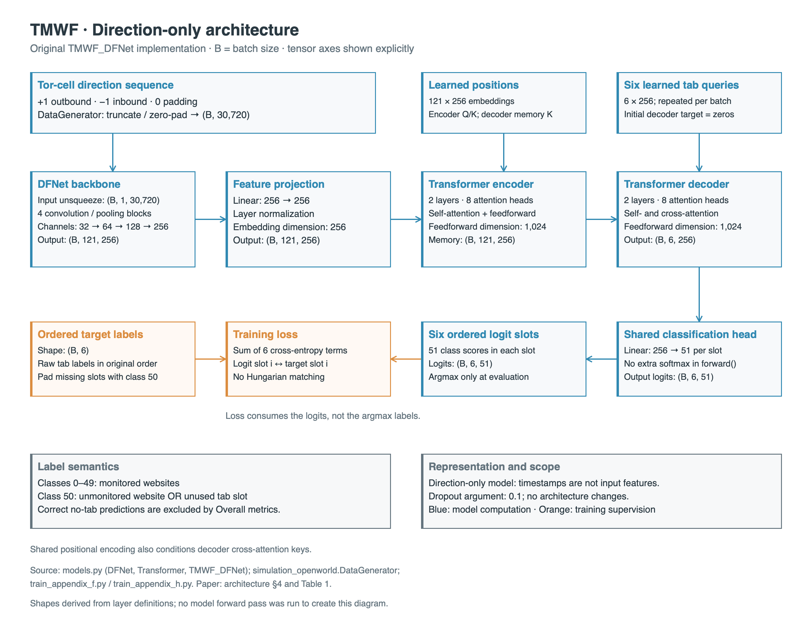
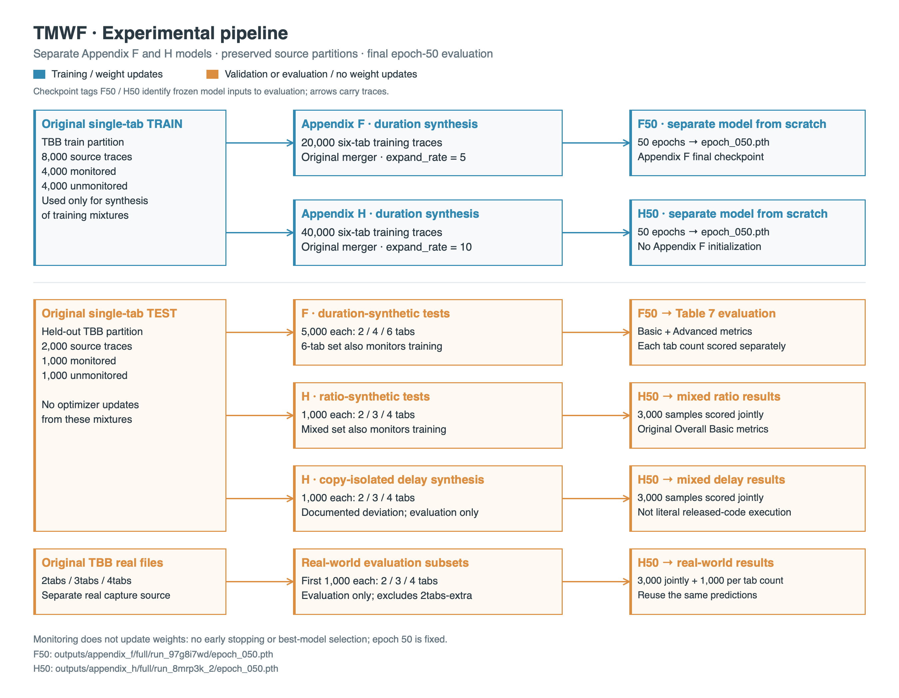
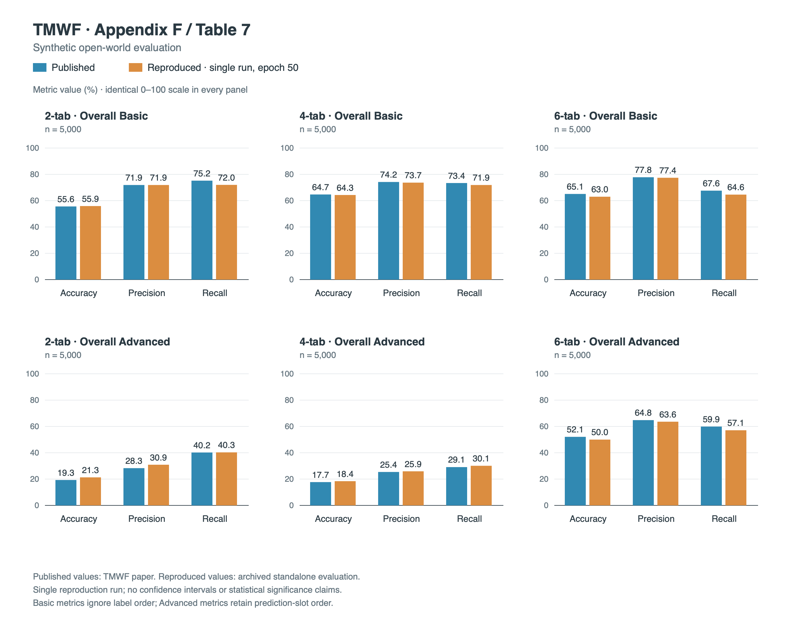
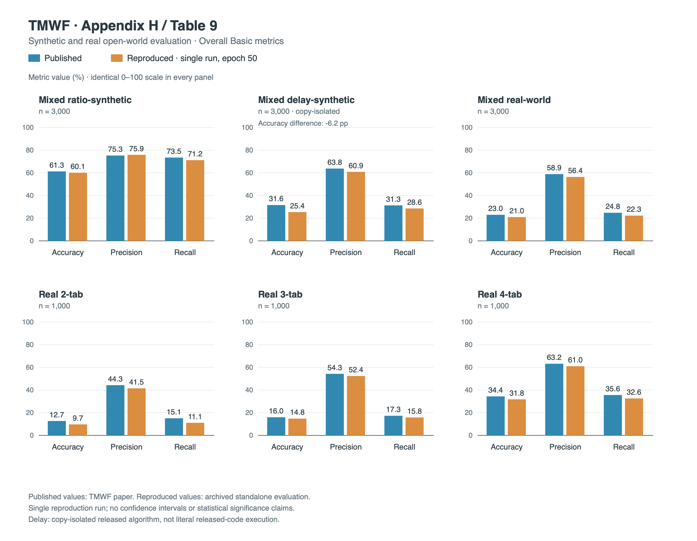

# Reproduction of TMWF: Appendix F/Table 7 and Appendix H/Table 9

**B.Tech CSE research-project report**  
**Evidence review date:** 24 October 2026  
**Paper:** Zhaoxin Jin, Tianbo Lu, Shuang Luo, and Jiaze Shang, *Transformer-based Model for Multi-tab Website Fingerprinting Attack*, ACM CCS 2023, DOI: 10.1145/3576915.3623107.

## 1. Executive summary and reproduction scope

This project reproduces the TMWF results for the authors' Tor Browser Bundle (TBB) datasets in Appendix F and Appendix H of the complete paper. Appendix F trains on 20,000 synthetic six-tab traces and evaluates 5,000 traces each with two, four, and six tabs. Appendix H trains a separate model on 40,000 synthetic six-tab traces and evaluates mixed ratio-synthetic, mixed delay-synthetic, and real multi-tab traffic. These counts follow Appendix F (p. 19) and Appendix H (p. 20); the comparison targets appear in Tables 7 and 9 (pp. 20–21). [P]

The archived standalone evaluations contain all **36 primary metrics** requested for this reproduction: 18 Overall Basic/Advanced values for Appendix F and 18 Overall Basic values for Appendix H. Recalculation from the printed values shows that **35 of 36 differ by at most 4.0 percentage points** from the published values. The exception is mixed-delay Basic Accuracy: **25.4% reproduced versus 31.6% published, a −6.2 pp difference**. The 4.0 pp band is a descriptive summary chosen for this project; it is neither a paper-defined acceptance threshold nor a statistical significance criterion. [F-log, H-log, D-log]

All three archived evaluators exited successfully, recorded their expected completion markers, and reported unchanged protected artifacts. This supports a **PASS for archived numerical evidence and execution integrity**, with **qualified protocol fidelity** for delay synthesis. The delay experiment deliberately uses independent input copies per sampled occurrence; it is not literal released-code execution. Numerical proximity does not establish exact or bitwise reproduction.

The scope excludes reproducing Adaptive-BAPM, Chrome experiments, Walkie-Talkie experiments, ablations, timing-input variants, and the base-rate study. No new training, synthesis, or inference was performed while preparing this report.

### 1.1 Student reproduction contributions

The original authors developed TMWF, its training approach and metrics, and collected the released datasets. This project's contributions are reproduction engineering and experimental analysis:

- Environment and device compatibility for the existing implementation.
- Dataset-generation adapters that invoke the original synthesis functions and preserve file formats.
- Structural, annotation-consistency, and file-integrity auditors.
- Investigation of delay-merger mutation and aliasing, with an explicitly documented per-occurrence copy-isolation protocol.
- Training and evaluation orchestration with recoverable checkpoints and fixed final-epoch selection.
- Reproducibility archiving and comparison of the measured results with the paper.

These contributions do not constitute a new fingerprinting architecture, loss, or metric. The corresponding scripts and evidence are indexed in Section 13. [GF, GH, GD, AF, AH, AD, TD, TF, TH, EF, EH, ED, A]

## 2. Paper background and research objective

Website fingerprinting (WF) identifies visited websites from observable traffic patterns despite encryption. Single-tab classifiers face difficulty when concurrently loaded pages interleave their packets. TMWF addresses this problem as ordered-set prediction: a fixed number of tab queries predicts website identities, while an additional “no-tab” class absorbs unmonitored pages and unused output positions. The model therefore does not require the actual tab count as an input. Its capacity remains bounded by the configured number of queries. [P, §§1, 4–5]

The complete paper distinguishes Walkie-Talkie data used for principal synthetic model-development experiments, Chrome traffic used for principal real open-world experiments, and the authors' TBB data used in the supplementary Appendix F/H experiments. This project uses the latter. Its objective is to reproduce the TBB numerical results and assess the limitations of transferring a model trained on synthetic mixtures to real traffic, while retaining the released architecture, training loss, and metric functions. [P, §5.3, pp. 8–10; Appendices F/H]

## 3. Threat model and multi-tab website fingerprinting problem

The paper considers an observer of the encrypted connection between a Tor client and its entry relay. Examples include a local-network observer, internet service provider (ISP), or entry-relay operator. The observer cannot directly read encrypted website content but can collect reference traces for monitored websites and classify observed traffic metadata. The open-world setting includes both monitored sites and a much larger collection of unmonitored sites. [P, §2, pp. 2–3]

For multi-tab traffic, directions from different page loads are interleaved, and individual page boundaries are unavailable to the classifier. Captured network packets and model sequence elements are not interchangeable: the paper describes extracting Tor-cell direction sequences from captured Transmission Control Protocol (TCP) packets. In that representation, +1 denotes a cell travelling from the client towards the website and −1 denotes the reverse direction. Zero denotes sequence padding, not a third traffic direction. This project consumes the released direction arrays; it does not repeat or independently verify the packet-to-cell extraction. “Packet-direction input” in the implementation refers to these stored directional traces. Timestamps support synthesis and integrity checks but are not model inputs. [P, §5.4, p. 9; Appendix G, p. 19; S, `DataGenerator.generate()`]

The balanced monitored/unmonitored source-trace pool is an experimental condition, not an estimate of real browsing prevalence. Consequently, these results cannot establish operational precision at a realistic low monitored-site base rate. [P, §2; S, M]

## 4. Original TMWF architecture and model configuration

DFNet is the Deep Fingerprinting (DF) convolutional neural network (CNN) backbone without its original classification head. The unchanged `TMWF_DFNet` combines this backbone with a linear projection and layer normalization, a Transformer encoder/decoder, learned positional embeddings, learned tab-query embeddings, and a classification layer. DFNet has four convolutional blocks with channel counts 32, 64, 128, and 256. The Transformer models global relationships in the extracted sequence, and its decoder generates a prediction for each tab query. [P, §4 and Table 1, p. 8; M]

| Setting | Value retained in both full runs |
|---|---|
| Input | Tor-cell direction sequence only; 30,720 positions |
| Backbone | Original DFNet; convolution/pool kernel sizes 8 |
| Embedding dimension | 256 |
| Encoder / decoder layers | 2 / 2 |
| Attention heads | 8 |
| Feedforward dimension | 1,024 |
| Positional embedding length (`max_len`) | 121 |
| Tab queries / classes | 6 / 51 |
| Dropout argument | 0.1 |
| Output | `(batch, 6, 51)` logits |
| Optimizer / learning rate | Adam / 0.0005 |
| Batch size / epochs | 80 / 50 |
| Loss | Sum of six slot-wise `CrossEntropyLoss` terms |

Architecture values are supported by the paper’s Table 1 and `models.py` (`DFNet`, `Transformer`, and `TMWF_DFNet`); optimization and execution settings are confirmed by the training scripts and final checkpoint metadata. The loss uses PyTorch's default mean reduction within each slot, then sums over the six slots. Prediction slot *i* is supervised directly by target label slot *i*, including class-50 padding where applicable. The `run()` training loops apply the instantiated cross-entropy criterion to `logits[:, i]` and `targets[:, i]`; they use neither Hungarian matching nor permutation-invariant supervision. Basic evaluation's use of unordered sets does not change this ordered training objective. [P, §4.1, p. 5; TF, TH]

No focal loss, scheduler, mixed precision, gradient accumulation, or early stopping is used in these pipelines. [M, TF, TH, CF, CH]

The original `simulation_openworld.DataGenerator.generate()` truncates long directions to 30,720 and zero-pads shorter directions at batch creation. Loaders preserve raw sequence lengths and order. Raw label rows are padded in memory to six slots with class 50. This is distinct from direction-sequence padding, whose value is zero. [S, LF, LH]

Figure 1 summarizes the direction-only model and its ordered six-slot supervision, distinguishing the model's logits from evaluation-time predictions.



**Figure 1. Original TMWF direction-only architecture.** The DFNet backbone and Transformer encoder–decoder map a 30,720-element direction sequence to six slots of 51 class logits. Shapes are derived from the implementation; class 50 represents an unmonitored website or an unused slot. [M, S, TF, TH]

## 5. Experimental environment and software versions

The final checkpoints and results archive record the following environment. MPS denotes the PyTorch backend using Apple Metal Performance Shaders. These are historical execution records, not an assertion about every future execution environment. [CF, CH, A]

| Component | Recorded value |
|---|---|
| Python | 3.9.6 |
| PyTorch | 2.8.0 |
| NumPy | 1.26.4 |
| Platform string | `macOS-26.7.1-arm64-arm-64bit` |
| Training and evaluation backend | MPS |
| Recorded CUDA devices | 0 |
| Delay-generation tqdm | 4.67.1 |
| Evaluator batch size | 80 |

The scripts select CUDA, then MPS, then CPU according to availability. Automatic MPS CPU fallback is not enabled by the reproduction workflow; the archive records no fallback environment value. The records do not independently establish the exact Apple chip model or installed RAM, so no chip-specific performance claim is made.

Process memory is reported as resident set size (RSS); the recorded value is the process lifetime peak.

| Measured operation | Recorded elapsed time | Largest logged process peak RSS |
|---|---:|---:|
| Appendix F standalone evaluator | 46.71 s | 724.42 MB |
| Appendix H ratio/real evaluator | 18.94 s | 560.69 MB |
| Appendix H delay evaluator | 10.08 s | 544.59 MB |
| Two-tab delay generation | 8.12 s | Not recorded in generation manifest |
| Three-tab delay generation | 13.61 s | Not recorded in generation manifest |
| Four-tab delay generation | 18.73 s | Not recorded in generation manifest |

Evaluator totals include setup and integrity work, not only model inference. Logged MPS driver-memory snapshots reach 2,313.91 MB in each evaluator; snapshots are not measured GPU-memory peaks. RSS is process lifetime peak RSS, not current resident usage, and should not be added to MPS memory as if the quantities were independent. MB denotes 1,000,000 bytes. Delay timings are rounded from the three manifests. No archived full-training wall-time or training peak-memory measurement was found; this report does not substitute checkpoint modification times or extrapolated runtimes for measurements. [F-log, H-log, D-log, D2, D3, D4]

## 6. Dataset descriptions, train/test partitions and label semantics

The released `dataset/tbb single tab/train` contains 8,000 traces: 4,000 monitored and 4,000 unmonitored. The released `test` contains 2,000: 1,000 monitored and 1,000 unmonitored. These counts were verified by reading the source label arrays during report preparation. The README describes 50 monitored websites with 100 traces each, a matching total of unmonitored traces, and a stratified 4:1 split. Original unmonitored labels are −1; synthesis maps them to class 50. Monitored labels are 0–49. [R, G]

| Dataset directory, relative to repository root | Source | Samples per job | Raw label width |
|---|---|---:|---:|
| `dataset/generated_appendix_f/train_6tab/` | Original `train` | 20,000 | 6 |
| `dataset/generated_appendix_f/test_2tab/` | Original `test` | 5,000 | 2 |
| `dataset/generated_appendix_f/test_4tab/` | Original `test` | 5,000 | 4 |
| `dataset/generated_appendix_f/test_6tab/` | Original `test` | 5,000 | 6 |
| `dataset/generated_appendix_h/train_6tab/` | Original `train` | 40,000 | 6 |
| `dataset/generated_appendix_h/ratio_test_2tab/` | Original `test` | 1,000 | 2 |
| `dataset/generated_appendix_h/ratio_test_3tab/` | Original `test` | 1,000 | 3 |
| `dataset/generated_appendix_h/ratio_test_4tab/` | Original `test` | 1,000 | 4 |
| `dataset/generated_appendix_h_delay/copy_isolated/delay_test_2tab/` | Original `test` | 1,000 | 2 |
| `dataset/generated_appendix_h_delay/copy_isolated/delay_test_3tab/` | Original `test` | 1,000 | 3 |
| `dataset/generated_appendix_h_delay/copy_isolated/delay_test_4tab/` | Original `test` | 1,000 | 4 |
| `dataset/tbb realworld/2tabs` | Original real multi-tab capture file | First 1,000 | 2 |
| `dataset/tbb realworld/3tabs` | Original real multi-tab capture file | First 1,000 | 3 |
| `dataset/tbb realworld/4tabs` | Original real multi-tab capture file | First 1,000 | 4 |

Generated training counts are supported by checkpoint index lengths and configured loader checks. Final evaluation counts are explicitly recorded in the archive. The first-1,000 real selection follows the released code's `front_part=1000` convention; the paper specifies sample counts but does not identify the exact selected rows. `2tabs-extra` is excluded. [CF, CH, LF, LH, F-log, H-log, D-log]

Here, “COCO-format chunks” means the generator's custom traffic serialization inspired by Common Objects in Context (COCO) annotations: pickle files containing direction/time arrays, accompanied by annotation JSON. These are not images from the COCO dataset. “BAPM labels” refers to the generator's `BAPM_*.npz` NumPy label archives, named after the Block Attention Profiling Model baseline discussed in the paper; using this storage format does not mean that BAPM was trained. In `CONJUNCTION` mode, these archives hold the raw tab-label rows. [G, `save_merged_traces()`; R, File Description] Chunks are read by numeric suffix, beginning at zero. The generator writes 1,000-sample chunks followed by an empty final chunk when the total is divisible by 1,000. The final-suffix BAPM archive contains labels for the complete job. These original files are retained without renaming or deletion. Empty chunks are skipped by loaders, not treated as empty samples. [G, LF, LH]

Class 50 denotes both unmonitored websites and unused model slots. All-unmonitored mixtures are retained. Sampling with replacement permits repeated source traces and repeated monitored labels. The source partitions are kept separate for synthesis; this does not make synthetic examples statistically independent, since examples can reuse constituent source traces.

Figure 2 makes the source-partition and training/evaluation separation explicit. Appendix F and H use separate models; held-out synthetic sets supply monitoring or evaluation data, while real-world and delay sets are used only for evaluation. Monitoring does not update model weights or select an alternative checkpoint.



**Figure 2. Experimental pipeline for the Appendix F/H reproduction.** Separate training branches produce fixed epoch-50 checkpoints, while evaluation branches preserve the stated source partitions and sample counts. Copy-isolated delay synthesis is an explicit deviation from literal released-code execution. [GF, GH, GD, TF, TH, LF, LH, EF, EH, ED]

## 7. Appendix F: synthesis protocol, training and Table 7 reproduction

Appendix F specifies duration-overlap six-tab training with 20,000 samples and separate 5,000-sample two-, four-, and six-tab validation datasets. The local runner invokes the original `merge_single_traces()` orchestration and duration merger. Candidate traces are drawn uniformly with replacement from the entire chosen partition. An overlap ratio is selected from `[0.1, 0.2, 0.3, 0.4, 0.5]`; the original purity threshold is 0.1, and rejected duration merges are retried. Uniformity applies to candidate selection in `merge_single_traces()`. Acceptance is conditional on `merge_with_durationscale()` succeeding, so the accepted-sample distribution need not be uniform over candidate combinations or overlap ratios. No empirical accepted-distribution measurement is claimed. [P, §5.4 and Appendices D/F; G, GF]

`expand_rate=5` yields five times the **monitored-prefix count**, not five times the full candidate-pool count: 5 × 4,000 = 20,000 training examples and 5 × 1,000 = 5,000 evaluation examples. The paper discusses a fivefold scale in §5.4, but does not name the implementation variable `expand_rate`; the wrapper's settings operationalize the explicit TBB target counts. Chunk size is `devide_num=1000`, with `task_type='multi'`, `save_format='CONJUNCTION'`, `complete_randomization=True`, and `padding=False`. Python and NumPy synthesis seeds are 2023. [GF, G]

The training script initializes the official model, uses all 20,000 training samples, and monitors `test_6tab` each epoch. NumPy and PyTorch seeds are 2023. Training indices are shuffled once, followed by validation indices, matching the original `train_test()` ordering; the permutation is reused across epochs. All 50 epochs are completed without best-model selection. The final checkpoint records `mode='full'`, `completed_epoch=50`, and training/validation index lengths of 20,000/5,000. [TF, S, CF]

Standalone evaluation loads this final checkpoint, uses `model.eval()` and `torch.inference_mode()`, and processes each 5,000-sample dataset separately in original order. It checks shapes, finite logits, and unchanged model state and input files. Table 7 comparisons in Section 9 use these standalone results, not training-time validation entries. The archive also retains Previous/per-page metrics, but those are outside the 36 primary values summarized here. [EF, F-log]

## 8. Appendix H: synthesis protocol, training and Table 9 reproduction

### 8.1 Duration-synthetic training and ratio validation

Appendix H specifies 40,000 six-tab ratio-synthetic training traces and mixed datasets containing 1,000 examples each of two, three, and four tabs. The duration runner uses `expand_rate=10` for training and 1 for each ratio-validation component, retaining the same original merger, overlap choices, purity threshold, sampling rules, seeds, and 1,000-sample chunking. [P, Appendix H; GH]

A separate TMWF model is trained from scratch on all 40,000 samples, rather than initialized from Appendix F. The H checkpoint explicitly records `parent_checkpoint=None`. Validation concatenates predictions and labels from the three ratio datasets and computes the original Basic metrics jointly over 3,000 samples. Real traffic is absent from the training and validation paths and is not used for checkpoint selection. Python, NumPy, and PyTorch seeds are 2023. Epoch-50 selection and this validation-monitoring convention are explicitly recorded reproduction choices. [TH, CH]

### 8.2 Real-world evaluation

The adapter explicitly loads TBB `2tabs`, `3tabs`, and `4tabs`, selecting the first 1,000 rows in each. It avoids the original `load_real_world()` implementation, which defaults to Chrome and excludes the requested tab before indexing the shortened list. The adapter preserves sequence order and applies the original direction-only batching behavior. Predictions are computed once per real component, reused for individual metrics, then concatenated for the mixed-real metrics. Mixed metrics are never obtained by averaging subgroup scores. [LH, EH, O]

### 8.3 Copy-isolated delay synthesis

The delay experiment is a **copy-isolated reproduction of the released TMWF delay-merging algorithm**, explicitly distinct from literal released-code execution. Three 1,000-trace jobs use the original held-out test partition, two/three/four tabs, `expand_rate=1`, `devide_num=1000`, and Python/NumPy seeds of 2023. The configured uniform-delay range is 2–9 seconds: §5.4 gives the lower bound of 2 seconds, and Appendix H increases the TBB upper bound to 9 seconds. [P, pp. 10, 20; GD, D2–D4]

The original `MergeSingleTraces_openworld.merge_with_delaytime()` function shifts selected timestamp arrays in place. Because the orchestration selects references and slicing can return NumPy views, repeated samples can inherit earlier shifts; duplicate source selections can alias within a merge. The runner’s `isolated_merger()` wrapper therefore copies **every selected timestamp and direction occurrence independently** immediately before calling the original delay function. A single job-level copy would not prevent contamination across subsequent merges. This changes input ownership and thus potentially changes generated traffic compared with literal execution; it does not change the merger's arithmetic, sampling with replacement, source packet order, or random-draw sequence. [G, GD, TD]

For successive uniform draws U1, U2, … from [2, 9], the released offset schedule is:

| Tabs | Applied offsets | Uniform draws consumed |
|---:|---|---:|
| 2 | 0, U1 | 3 |
| 3 | 0, U1, U1 + U2 + U3 | 5 |
| 4 | 0, U1, U1 + U2 + U3, U1 + U2 + U3 + U4 + U5 | 7 |

Thus the first inter-tab increment uses one draw; subsequent increments use two and can range from 4 to 18 seconds. The last two draws do not affect that merge's offsets but advance random state. The otherwise unused `random.choice(overlapped_ratios)` is also preserved in delay mode. No duration-purity rejection is added. The diagnostic fixtures specify draws 2, 3, 4, 5, 6, 7, 8 and corresponding offsets `[0, 2]`, `[0, 2, 9]`, `[0, 2, 9, 20]`; these are test expectations, not sampled research-data measurements. [G, GD, TD]

Appendix E's wording about an additional delay when the page count exceeds three is not identical to §5.4's description before the third page. This reproduction retains the audited released scheduling rather than silently resolving that textual ambiguity. Uniform 2–9-second draws must not be described as uniformly distributed 2–9-second increments at every boundary.

The delay manifests record completed jobs, settings, seeds, software, source/code hashes before and after generation, output hashes, and sample counts. Annotation JSON files intentionally contain empty `traces`, `annotations`, and `categories` lists. **Annotation-label alignment is unavailable for delay synthesis.** No annotations were fabricated. [GD, AD, D-log]

The archived delay audit reports timestamp reversals in 12, 18, and 21 traces for the two-, three-, and four-tab datasets, respectively, with one negative adjacent difference in each affected trace. Maximum backward jumps are approximately 1.04904 × 10⁻⁵, 1.14441 × 10⁻⁵, and 1.14441 × 10⁻⁵ seconds. These were reported and preserved, not sorted or normalized away. Although timestamps are not model features, their ordering affects synthesis. [D-log]

## 9. Original-versus-reproduced results

### 9.1 Metric definitions and reporting convention

The implementation calls the unchanged functions in `metrics.py`. Overall Basic metrics discard class 50 and represent each sample's monitored predictions and targets as sets, ignoring order and duplicate occurrences. Basic Accuracy is the sum of intersection sizes divided by the sum of the larger predicted/true set size for each sample. It is not exact-match sample accuracy. Basic Precision and Recall are macro-averages over the 50 monitored classes. [P, §5.2, p. 7; K]

Overall Advanced metrics operate slot-wise and preserve order and repeated labels. Advanced Accuracy counts correctly predicted monitored slots over all slots except correctly predicted no-tab/no-tab pairs. Advanced Precision and Recall likewise macro-average monitored-class slot counts. The implementation replaces zero precision/recall denominators with one, making those class contributions zero. The original functions round fractional scores to three decimal places; this report displays percentages to one decimal place. No alternative metrics or rounding rules were substituted. [K]

The 36 reported metrics are not statistically independent observations: they share trained models, source pools, and predictions, and the mixed-real scores reuse the individual-real component predictions. Counting values inside a difference band therefore does not constitute 36 independent replication trials.

Every difference below is **reproduced minus published**, in percentage points, calculated from the archived displayed values. The F log's `−0.0` precision display is normalized to `+0.0` because 71.9 − 71.9 is exactly zero at the reported precision.

### 9.2 Appendix F / Table 7: all 18 primary metrics

Published values: paper Table 7, p. 20. Reproduced values: [F-log].

**Report Table 1. Appendix F comparison: all 18 Overall Basic and Overall Advanced metrics for the final epoch-50 model. Differences are reproduced minus published, in percentage points.**

| Dataset (samples) | Metric | Published (%) | Reproduced (%) | Difference (pp) |
|---|---|---:|---:|---:|
| test_2tab (5,000) | Overall Basic Accuracy | 55.6 | 55.9 | +0.3 |
| test_2tab (5,000) | Overall Basic Precision | 71.9 | 71.9 | +0.0 |
| test_2tab (5,000) | Overall Basic Recall | 75.2 | 72.0 | -3.2 |
| test_2tab (5,000) | Overall Advanced Accuracy | 19.3 | 21.3 | +2.0 |
| test_2tab (5,000) | Overall Advanced Precision | 28.3 | 30.9 | +2.6 |
| test_2tab (5,000) | Overall Advanced Recall | 40.2 | 40.3 | +0.1 |
| test_4tab (5,000) | Overall Basic Accuracy | 64.7 | 64.3 | -0.4 |
| test_4tab (5,000) | Overall Basic Precision | 74.2 | 73.7 | -0.5 |
| test_4tab (5,000) | Overall Basic Recall | 73.4 | 71.9 | -1.5 |
| test_4tab (5,000) | Overall Advanced Accuracy | 17.7 | 18.4 | +0.7 |
| test_4tab (5,000) | Overall Advanced Precision | 25.4 | 25.9 | +0.5 |
| test_4tab (5,000) | Overall Advanced Recall | 29.1 | 30.1 | +1.0 |
| test_6tab (5,000) | Overall Basic Accuracy | 65.1 | 63.0 | -2.1 |
| test_6tab (5,000) | Overall Basic Precision | 77.8 | 77.4 | -0.4 |
| test_6tab (5,000) | Overall Basic Recall | 67.6 | 64.6 | -3.0 |
| test_6tab (5,000) | Overall Advanced Accuracy | 52.1 | 50.0 | -2.1 |
| test_6tab (5,000) | Overall Advanced Precision | 64.8 | 63.6 | -1.2 |
| test_6tab (5,000) | Overall Advanced Recall | 59.9 | 57.1 | -2.8 |



**Figure 3. Appendix F/Table 7 quantitative comparison.** Published and reproduced Overall Basic and Overall Advanced Accuracy, Precision, and Recall for 5,000 samples per tab count. Reproduced values are from the single-run, epoch-50 standalone evaluation; all panels use a 0–100% scale. [F-log]

Figure 3 visualizes Report Table 1: the largest absolute difference among these 18 metrics is 3.2 pp. The chart presents descriptive comparisons, without confidence intervals or statistical significance claims.

### 9.3 Appendix H / Table 9: all 18 primary metrics

Published values: paper Table 9, p. 21. Reproduced values: [H-log, D-log]. The three mixed groups each contain 3,000 samples; individual real groups reuse the mixed-real component predictions.

**Report Table 2. Appendix H comparison: all 18 Overall Basic metrics for the final epoch-50 model. The mixed-delay group uses the disclosed copy-isolated protocol.**

| Evaluation group (samples) | Overall Basic metric | Published (%) | Reproduced (%) | Difference (pp) |
|---|---|---:|---:|---:|
| mixed_ratio (3,000) | Accuracy | 61.3 | 60.1 | -1.2 |
| mixed_ratio (3,000) | Precision | 75.3 | 75.9 | +0.6 |
| mixed_ratio (3,000) | Recall | 73.5 | 71.2 | -2.3 |
| mixed_delay (3,000) | Accuracy | 31.6 | 25.4 | -6.2 |
| mixed_delay (3,000) | Precision | 63.8 | 60.9 | -2.9 |
| mixed_delay (3,000) | Recall | 31.3 | 28.6 | -2.7 |
| mixed_real (3,000) | Accuracy | 23.0 | 21.0 | -2.0 |
| mixed_real (3,000) | Precision | 58.9 | 56.4 | -2.5 |
| mixed_real (3,000) | Recall | 24.8 | 22.3 | -2.5 |
| real_2tab (1,000) | Accuracy | 12.7 | 9.7 | -3.0 |
| real_2tab (1,000) | Precision | 44.3 | 41.5 | -2.8 |
| real_2tab (1,000) | Recall | 15.1 | 11.1 | -4.0 |
| real_3tab (1,000) | Accuracy | 16.0 | 14.8 | -1.2 |
| real_3tab (1,000) | Precision | 54.3 | 52.4 | -1.9 |
| real_3tab (1,000) | Recall | 17.3 | 15.8 | -1.5 |
| real_4tab (1,000) | Accuracy | 34.4 | 31.8 | -2.6 |
| real_4tab (1,000) | Precision | 63.2 | 61.0 | -2.2 |
| real_4tab (1,000) | Recall | 35.6 | 32.6 | -3.0 |



**Figure 4. Appendix H/Table 9 quantitative comparison.** Published and reproduced Overall Basic Accuracy, Precision, and Recall for three mixed groups (3,000 samples each) and three individual real-world groups (1,000 each). Reproduced values are single-run, epoch-50 standalone results on a common 0–100% scale; the mixed-delay data use the disclosed copy-isolated protocol. [H-log, D-log]

Figure 4 highlights the synthetic-to-real performance gap and the mixed-delay Basic Accuracy discrepancy of −6.2 pp. These descriptive differences do not establish statistical significance or identify the cause of the delay discrepancy.

All requested metrics are traceable to archived logs. Appendix F's largest absolute difference is 3.2 pp. The only primary difference exceeding 4.0 pp is delay Basic Accuracy. Previous/per-page metrics are outside this primary comparison; some have larger differences.

## 10. Validation behavior and synthetic-to-real generalization

Checkpoint metadata provides monitoring evidence separate from final standalone evaluation. Reading the available epoch checkpoints identifies the following Basic Accuracy maxima; no earlier checkpoint was evaluated or selected to replace epoch 50 during report preparation. [CF, CH, CF39, CH12]

**Report Table 3. Training-time validation monitoring, distinct from standalone evaluation. Peak entries are stored in the `validation_metrics` field of the cited historical checkpoints.**

| Run | Monitoring dataset | Highest recorded Basic Accuracy | Epoch | Epoch-50 monitoring accuracy |
|---|---|---:|---:|---:|
| Appendix F | 5,000 six-tab ratio traces | 63.9% | 39 | 63.0% |
| Appendix H | Mixed ratio, 3,000 traces | 68.7% | 12 | 60.1% |

These are maxima of **Basic Accuracy**, not a claim that one epoch maximizes every metric. The H decline of 8.6 pp from its accuracy peak to epoch 50 shows that the final checkpoint is not the validation-accuracy optimum. This is consistent with possible overfitting or changing optimization behavior, but does not by itself establish a cause. No archived training-loss trajectory was found to support a stronger diagnosis. The reported primary results remain final-epoch standalone evaluations under the stated selection rule.

The reproduced mixed-real versus mixed-ratio differences are −39.1 pp Accuracy, −19.5 pp Precision, and −48.9 pp Recall, derived directly from Section 9. In the paper, the corresponding Accuracy difference is −38.3 pp. Both therefore exhibit a substantial synthetic-to-real generalization gap. [P, Table 9; H-log]

A plausible explanation is distribution mismatch: ratio synthesis imposes overlap and pure-segment conditions, whereas genuine browsing can contain non-overlapping pages or largely obscured pages. Independently captured single-tab traces also cannot fully recreate joint browser/network behavior. Appendix H discusses first-party domain circuit isolation and network variability as possible contributors, with insufficient training coverage of those conditions. These are paper-supported hypotheses, not causal findings established by this reproduction. [P, Appendix E, p. 18; Appendix H, p. 20]

Delay Basic Accuracy (25.4%) is closer to mixed-real Accuracy (21.0%) than ratio Accuracy (60.1%) is, consistent with the paper's qualitative observation. Nevertheless, delay-versus-real similarity does not validate exact collection-process equivalence, and the −6.2 pp discrepancy from the published delay accuracy remains unresolved.

## 11. Deviations from the released implementation

| Reproduction choice or change | Rationale and qualification |
|---|---|
| CUDA → MPS → CPU selection, `.to(device)`, checkpoint mapping | Enables the recorded MPS execution. Backend differences may affect numerical trajectories. Existing changes are confined to device handling in the two original experiment scripts. |
| Dedicated runners, loaders, trainers, evaluators, auditors | Resolve local paths, chunk discovery and provenance without changing model/metric/synthesis source. New scripts are separate from the original entry points. |
| Numeric chunk ordering and original filenames retained | Avoids manual renaming suggested by the README and correctly handles empty final chunks. |
| Explicit TBB real loader | Avoids Chrome defaults and the original tab-indexing bug while retaining first-1,000 selection and direction preprocessing. |
| Seed 2023, monitored-prefix multipliers, 1,000-sample chunking | Explicit implementation choices; generation seeds/chunk size are not asserted to be fully specified by the paper. Training seeds follow the original script convention. |
| Epoch-50 selection and monitoring sets | Fixed reproduction protocol, with no early stopping or selection of the earlier validation peak. |
| Per-occurrence delay copies | Deliberate scientific deviation preventing timestamp contamination and duplicate-reference aliasing. Literal outputs may differ. |
| Recoverable checkpoints and integrity checks | Additional metadata and verification; no alteration to optimization formulas. |

The repository HEAD is `f593e8afba22750edae23c0c0c32ddf6a62772d4`, with remote identity `https://github.com/jzx-bupt/TMWF.git`. At review, `models.py`, `metrics.py`, and `MergeSingleTraces_openworld.py` have no difference from that commit. The tracked modifications are `simulation_openworld.py` and `real_openworld.py`; reproduction scripts and generated artifacts are additional local files. The HEAD alone therefore does not identify the complete reproduction workspace. Checkpoint and archive source fingerprints provide the relevant file-level identities. [A, CF, CH; repository inspection]

## 12. Scientific limitations and threats to validity

1. **Single-run evidence.** No independent multi-seed replication, confidence intervals, or significance tests are reported. Metric differences and the 4 pp descriptive band cannot quantify sampling or training uncertainty.
2. **Dependent synthetic samples.** Uniform sampling with replacement reuses a finite source pool. Shared seeds and source pools across jobs do not establish independent validation populations. The H training set is generated separately; it is not documented as an independent new traffic capture or as a concatenation of the F set.
3. **Source-data provenance.** The project uses released pickle partitions, not new packet captures. Hashes establish identity relative to recorded local artifacts, not authenticity of the authors' original captures, absence of cross-partition duplicates, exact browser/network conditions, or correctness of every original label. No independent capture reconstruction or archive-member comparison is claimed. The README itself cautions that VPS resource limitations and browser access failures may reduce dataset trustworthiness. [R]
4. **Audit evidence boundaries.** Duration auditors implement monitored-label multiset comparison between BAPM labels and COCO annotations, including duplicate counts. Separate historical duration-audit terminal outputs were not found in the results archive. Their earlier reported success is not presented as a newly archived proof. Delay structural audits are embedded in D-log, but annotation alignment is unavailable. Neither structural validity nor annotation agreement reconstructs original traffic provenance.
5. **Delay ambiguity and mutation.** The ownership deviation and paper/code scheduling ambiguity described in Section 8.3 limit exact protocol attribution. No experiment here isolates whether copy ownership, source sampling, training stochasticity, or another factor explains the delay accuracy discrepancy.
6. **Timestamp reversals.** Minor reversals remain. The released pointer-based delay merge operates on existing source order; no correction was introduced. Structural acceptance does not demonstrate a mathematically sorted output or exact paper-level timing fidelity.
7. **Validation reuse.** The six-tab F validation data and mixed-ratio H data are monitored during training and reported again in final evaluation. They are not untouched validation holdouts. The fixed epoch rule limits checkpoint selection, but does not turn monitoring data into independent evidence of generalization. Real and delay datasets are absent from the training/monitoring code paths.
8. **Backend and resume limitations.** Saved optimizer and RNG states support epoch-boundary recovery, but do not guarantee bitwise identity across MPS/CUDA/CPU, software versions, or nondeterministic kernels. The final F metadata does not contain a parent-checkpoint field; H explicitly records no parent. No undocumented resume history is inferred.
9. **Scope and base rate.** The report does not reproduce the paper's comparative baseline advantage, all browsing environments, larger tab counts, or realistic monitored-site prevalence. First-1,000 selection may be sensitive to original file ordering, and no alternate-subset study was performed.
10. **Incomplete performance records.** Final evaluation timings and delay-generation timings are archived; training wall time, training peak memory, and a complete training-loss log are not. No missing measurement is reconstructed from memory.

## 13. Reproducibility instructions, checkpoint paths and archived evidence

### 13.1 Final checkpoints and archive

Paths below are relative to the repository root. The inspected final checkpoints both contain `state_dict`, `optimizer_state_dict`, `completed_epoch`, RNG states, sample permutations, settings, environment, source/data fingerprints, and validation metrics.

| Run | Final checkpoint | SHA-256 |
|---|---|---|
| Appendix F | `outputs/appendix_f/full/run_97g8i7wd/epoch_050.pth` | `c610dfe507fd4ac228d63e44dcbc70edc5df4a23aade805fd10e07d50bc77882` |
| Appendix H | `outputs/appendix_h/full/run_8mrp3k_2/epoch_050.pth` | `005543d6880dad5fad78852effc54d66d53146bb9e58fbdf3ebfb676fb9a98af` |

The latest successful archive is:

`outputs/reproducibility/20261024T043555_230947Z_ff51ccec4ff24cea94ee5447d807fbbe/`

Its `summary.json` records success for all three evaluators and equal pre/post hashes for 105 protected file entries. Its stated hash policy excludes training datasets; evaluation-time integrity must not be misreported as a fresh full-training-data audit. Log, checkpoint, and evaluator-script SHA-256 values were recomputed during report preparation and match the manifest. Large dataset files were not rehashed for this document; their unchanged status is the archived pre/post evidence.

| Archived evaluator | Exit | Completion markers | Log SHA-256 |
|---|---:|---|---|
| Appendix F Table 7 | 0 | Present | `44e888f55751643164ab6bf1a1ef642ace9b936539b6af72df33122986f054cc` |
| Appendix H ratio/real | 0 | Present | `8944def359cc4926db9429a17c565c3ce533c658d137f5e888332cc9c632a3d1` |
| Appendix H delay | 0 | Present | `5c2a0aae2d4eda805cfe3d680df9f9a78087accb0a34743c34e7ccb0231b7aec` |

The raw logs are authoritative for numerical results; `summary.json` intentionally does not parse metrics. Intermediate evaluator JSON records retain `completed_pending_integrity`, while the final summary resolves success. The ratio/real log's “delay not yet performed” message refers to that evaluator's scope; the separate delay log completes the group. Neither detail represents a failed final archive.

### 13.2 Prerequisites and commands for the prepared workspace

**Reproducibility boundary.** The commands below assume a prepared workspace, not a clean machine. The inspected project contains `.venv/`, the extracted original datasets, the generated datasets, and the added reproduction scripts. No project dependency lockfile or verified end-to-end clean-machine installation procedure was found. The following are prerequisites, not a claim that fresh installation has been tested:

- A compatible Python environment with PyTorch, NumPy, and tqdm. The inspected environment contains Python 3.9.6, PyTorch 2.8.0, NumPy 1.26.4, and tqdm 4.67.1. The relevant code otherwise uses Python standard-library modules, including Unix `resource`; platform-specific portability has not been established. GPU execution requires a supported backend. Recorded runs used MPS.
- The original TBB source partitions extracted at `dataset/tbb single tab/train` and `dataset/tbb single tab/test`, and real files under `dataset/tbb realworld/`. The repository contains `dataset/tbb single tab.tar.gz` and `dataset/tbb realworld.tar.gz`, but this report does not claim a verified extraction/installation procedure or archive-member provenance comparison.
- The additional project scripts listed in Section 13.3, including `code/archive_tmwf_results.py`, together with the documented device-compatibility changes. **The pinned official upstream commit does not include these added reproduction scripts.** An examiner must obtain the accompanying project workspace from the student, or a separately supplied versioned copy of those additions; cloning upstream alone cannot run these commands. No public release URL for the additions is asserted.
- For rerunning final evaluation: the already generated evaluation datasets, delay manifests, referenced source files required by fingerprint checks, and the exact final checkpoints in Section 13.1. Their identities must match the recorded evidence. Historical checkpoints are needed only to inspect monitoring history, not to replace the final model.
- For archiving or new generation/training: writable output locations and sufficient compute/storage resources. Quantified full-training memory and runtime requirements remain unverified; Section 5 reports only actual archived measurements.

**Rerunning evaluation** uses existing generated traces and fixed epoch-50 weights; it does not reproduce their generation or training. Run the following from the `TMWF` repository root using the prepared environment. These commands are documentation only; none was executed while revising the report. Load only trusted local pickle/checkpoint artifacts. The F evaluator has no mode flag and starts inference immediately.

```sh
# Static archiver checks: no inference.
.venv/bin/python -B code/archive_tmwf_results.py --check

# Standalone final evaluation: these commands DO perform inference.
.venv/bin/python -B code/evaluate_appendix_f.py
.venv/bin/python -B code/evaluate_appendix_h.py --evaluate
.venv/bin/python -B code/evaluate_appendix_h_delay.py --evaluate

# Rerun all three evaluators into a new archive without overwriting prior logs.
.venv/bin/python -B code/archive_tmwf_results.py --archive
```

**Generating datasets and training from scratch** is a separate, expensive workflow. It assumes the same source partitions, compatible environment, and project additions are already in place, with the target generated-output directories absent. It does not begin from raw network captures. The synthesis jobs are:

```sh
for job in train_6tab test_2tab test_4tab test_6tab; do
  .venv/bin/python -B code/run_appendix_f_synthesis.py --job "$job"
done
for job in train_6tab ratio_test_2tab ratio_test_3tab ratio_test_4tab; do
  .venv/bin/python -B code/run_appendix_h_synthesis.py --job "$job"
done
for job in delay_test_2tab delay_test_3tab delay_test_4tab; do
  .venv/bin/python -B code/run_appendix_h_delay_synthesis.py --job "$job"
done
```

These generate data and should not be run against the completed experiment as a verification step. Existing populated outputs are protected. The respective auditors accept `--job` with the same job names:

```sh
.venv/bin/python -B code/audit_appendix_f_synthesis.py --job train_6tab
.venv/bin/python -B code/audit_appendix_h_synthesis.py --job train_6tab
.venv/bin/python -B code/audit_appendix_h_delay.py --job delay_test_2tab
```

Repeat the relevant auditor for each generated job before training/evaluation. Fresh full training is explicitly selected with:

```sh
.venv/bin/python -B code/train_appendix_f.py --full
.venv/bin/python -B code/train_appendix_h.py --full
```

These are expensive training commands, not required to inspect the archived results. They create new run directories. Existing evaluators are intentionally pinned to the completed runs above; they do not automatically select a newly trained or better-performing checkpoint. Evaluating a future run requires a separately reviewed path update or new evaluator, not silent checkpoint substitution.

### 13.3 Academic references and local evidence index

**Academic references**

1. Zhaoxin Jin, Tianbo Lu, Shuang Luo, and Jiaze Shang. 2023. “Transformer-Based Model for Multi-Tab Website Fingerprinting Attack.” In *Proceedings of the 2023 ACM SIGSAC Conference on Computer and Communications Security (CCS ’23)*, Copenhagen, Denmark. Association for Computing Machinery, New York, NY, USA, pp. 1050–1064. DOI: [10.1145/3576915.3623107](https://doi.org/10.1145/3576915.3623107). Bibliographic metadata follows the official README's BibTeX entry. Appendix references in this report refer to the accompanying complete 21-page version, rather than the 15-page proceedings pagination.
2. jzx-bupt. *TMWF: official source code and released datasets*. GitHub repository: [https://github.com/jzx-bupt/TMWF](https://github.com/jzx-bupt/TMWF), pinned commit `f593e8afba22750edae23c0c0c32ddf6a62772d4`. Repository identity and commit were verified from the local checkout on 24 October 2026. The project's additional scripts and modifications are identified separately above.

**Local evidence index**

The keys below identify artifacts in the accompanying workspace; they are not externally accessible scholarly citations or claims of public artifact availability. Links are relative to this report. In-text [P] identifies the complete version of reference 1, while [R] identifies the local README from reference 2. Code entries name the functions relevant to the claims, and checkpoint entries identify the stored evidence directly.

- **[P]** [Complete paper](../complete_paper_version_of_TMWF.pdf).
- **[R]** [Official README](../README.md).
- **[M]** [Original architecture](../code/models.py): `DFNet`, `Transformer`, and `TMWF_DFNet.forward()`.
- **[K]** [Original metrics](../code/metrics.py): `overall_basic_accuracy()`, `overall_basic_precision()`, `overall_basic_recall()`, `overall_advanced_accuracy()`, `overall_advanced_precision()`, and `overall_advanced_recall()`.
- **[S]** [Original simulation/DataGenerator](../code/simulation_openworld.py): `DataGenerator.generate()` and `train_test()`.
- **[O]** [Original real-world entry point](../code/real_openworld.py).
- **[G]** [Original synthesis implementation](../code/MergeSingleTraces_openworld.py): `merge_single_traces()`, `merge_with_durationscale()`, `merge_with_delaytime()`, and `save_merged_traces()`.
- **[GF]** [Appendix F generation](../code/run_appendix_f_synthesis.py).
- **[GH]** [Appendix H duration generation](../code/run_appendix_h_synthesis.py).
- **[GD]** [Copy-isolated delay generation](../code/run_appendix_h_delay_synthesis.py).
- **[TD]** [Deterministic delay diagnostic](../code/test_appendix_h_delay.py).
- **[LF]** [Appendix F loader](../code/appendix_f_data.py).
- **[LH]** [Appendix H loader](../code/appendix_h_data.py).
- **[TF]** [Appendix F training](../code/train_appendix_f.py).
- **[TH]** [Appendix H training](../code/train_appendix_h.py).
- **[EF]** [Appendix F evaluation](../code/evaluate_appendix_f.py).
- **[EH]** [Appendix H ratio/real evaluation](../code/evaluate_appendix_h.py).
- **[ED]** [Appendix H delay evaluation](../code/evaluate_appendix_h_delay.py).
- **[AF]** [Appendix F auditor](../code/audit_appendix_f_synthesis.py).
- **[AH]** [Appendix H duration auditor](../code/audit_appendix_h_synthesis.py).
- **[AD]** [Delay auditor](../code/audit_appendix_h_delay.py).
- **[CF39]** [F epoch-39 checkpoint](../outputs/appendix_f/full/run_97g8i7wd/epoch_039.pth): `completed_epoch=39`, `validation_metrics.overall_basic_accuracy=0.639`.
- **[CH12]** [H epoch-12 checkpoint](../outputs/appendix_h/full/run_8mrp3k_2/epoch_012.pth): `completed_epoch=12`, `validation_metrics.overall_basic_accuracy=0.687`.
- **[AR]** [Results archiver](../code/archive_tmwf_results.py): `--check` and `--archive` workflows.
- **[CF]** [Final F checkpoint](../outputs/appendix_f/full/run_97g8i7wd/epoch_050.pth).
- **[CH]** [Final H checkpoint](../outputs/appendix_h/full/run_8mrp3k_2/epoch_050.pth).
- **[A]** [Final archive manifest](../outputs/reproducibility/20261024T043555_230947Z_ff51ccec4ff24cea94ee5447d807fbbe/summary.json).
- **[F-log]** [appendix_f_table7 archived log](../outputs/reproducibility/20261024T043555_230947Z_ff51ccec4ff24cea94ee5447d807fbbe/20261024T043555_230947Z_appendix_f_table7.log).
- **[H-log]** [appendix_h_ratio_real_table9 archived log](../outputs/reproducibility/20261024T043555_230947Z_ff51ccec4ff24cea94ee5447d807fbbe/20261024T043555_230947Z_appendix_h_ratio_real_table9.log).
- **[D-log]** [appendix_h_delay_table9 archived log](../outputs/reproducibility/20261024T043555_230947Z_ff51ccec4ff24cea94ee5447d807fbbe/20261024T043555_230947Z_appendix_h_delay_table9.log).
- **[D2]** [2-tab delay generation manifest](../dataset/generated_appendix_h_delay/copy_isolated/delay_test_2tab/manifest.json).
- **[D3]** [3-tab delay generation manifest](../dataset/generated_appendix_h_delay/copy_isolated/delay_test_3tab/manifest.json).
- **[D4]** [4-tab delay generation manifest](../dataset/generated_appendix_h_delay/copy_isolated/delay_test_4tab/manifest.json).

## 14. Conclusion

The project provides traceable numerical reproduction evidence for the TMWF TBB experiments in Appendix F/Table 7 and Appendix H/Table 9. Both models completed the configured 50 epochs, and archived standalone evaluations provide all 36 primary comparisons with successful integrity checks. The results reproduce the broad pattern of stronger ratio-synthetic performance and substantially weaker real-world performance.

These findings are qualified by the protocol deviation and evidence limitations in Sections 8.3 and 12; numerical proximity does not establish exact protocol identity. Mixed-delay Basic Accuracy is 6.2 pp below the paper and should remain visible in the final submission. Additional experiments are not necessary to substantiate the archived measurements themselves. Independent-seed replication, a controlled literal-versus-copy-isolated delay study, and improved source-capture provenance would be needed for stronger claims about robustness, discrepancy causes, or real deployment. These are proposed future work, not completed experiments.
